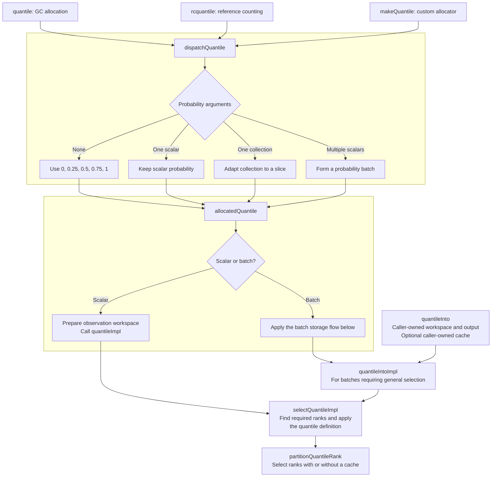
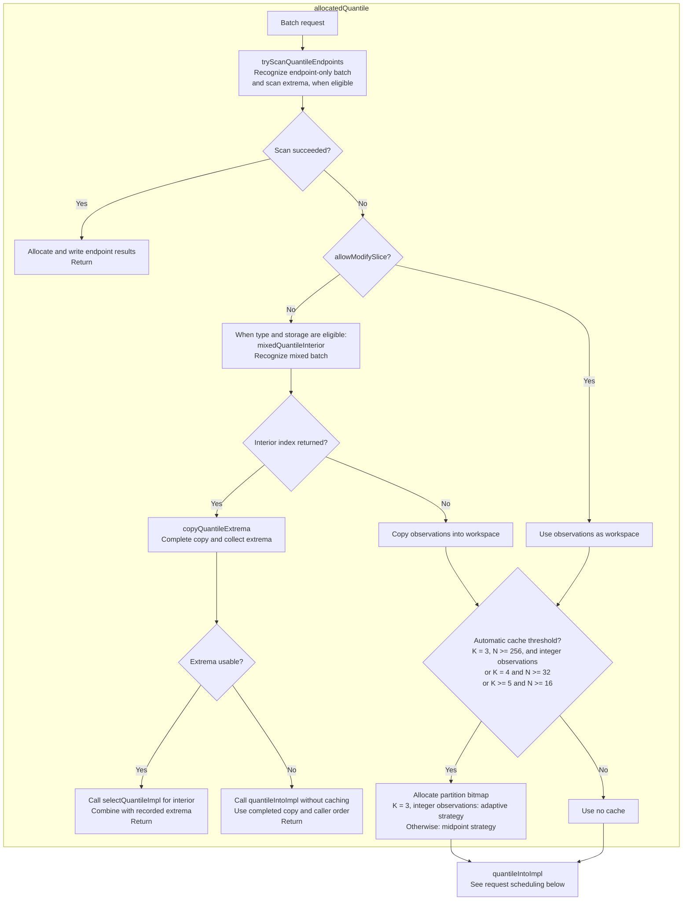
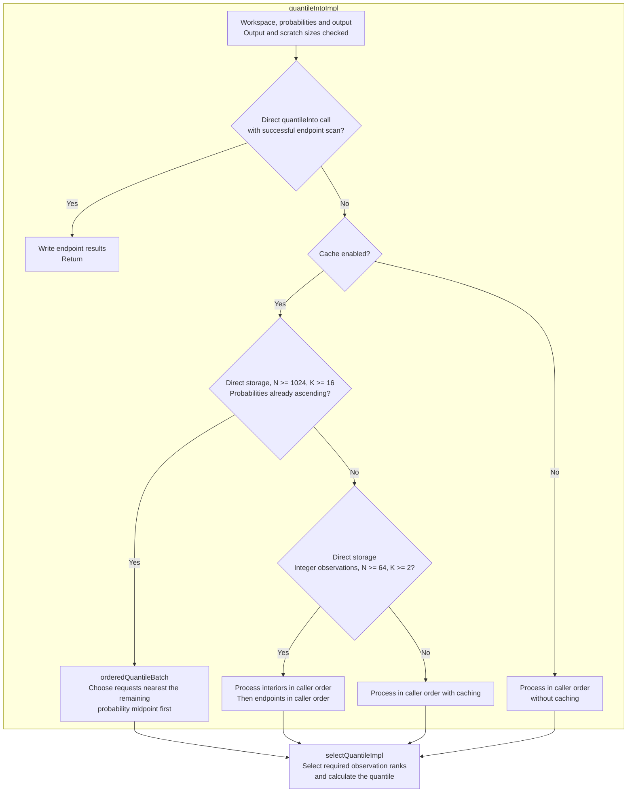

# Ordinary quantile selection

These diagrams describe how ordinary quantile calls prepare storage and select observations. They document internal implementation choices, including performance thresholds, rather than API guarantees. Weighted quantiles, scalar median functions, and persistent quantile tables are outside these diagrams' scope.

Later sections describe weighted selection and cumulative-weight preparation for sorted workspaces.

## Entry points and shared implementation

`quantileAssumeSorted` accepts ascending arrays, Mir slices, and Phobos `SortedRange` inputs with the default ascending predicate. It indexes the required ranks directly using the existing type 1-9 formulas and interpolation. `quantileRanks` determines the required indices and interpolation fraction. Unsorted selection establishes those indices before evaluation, while sorted lookup evaluates them directly. Scalar calls need no workspace. Batch calls allocate only the result. `rcquantileAssumeSorted` and `makeQuantileAssumeSorted` use the same rank lookup with reference-counted and caller-allocated batch results. `quantileAssumeSortedInto` writes directly into supplied output. All three owning policies share the output loop with the caller-storage path. The ordinary GC, RC, custom allocator, and three-argument `quantileInto` entry points forward a default ascending `SortedRange` at compile time.

GC, RC, and custom-allocation quantile functions share the selection logic. Their allocation policy determines how temporary and result storage is owned and released. Boxes group work by function; a node naming another function represents a call to it.



`quantileInto` bypasses allocation and copying. Its scratch-buffer overload explicitly requests caching independently of the automatic thresholds used by allocating functions. Its overload without scratch performs uncached selection.

## Batch storage and shortcuts

**N** is the observation count and **K** is the probability count. Results always appear in the caller's probability order, even when computation happens in a different order. This diagram shows the batch path inside `allocatedQuantile`.



Type and storage eligibility is checked by `allocatedQuantile` before it calls the helpers. `mixedQuantileInterior` recognizes a batch of exactly three probabilities with N >= 64, beginning with an endpoint and containing both endpoints and one strictly interior probability. It returns index 1 or 2; zero means ordinary selection. This shortcut applies to integers, `float`, and `double` when copying is required.

For example, 100 integer observations and probabilities `[0, 0.5, 1]` use the copy to record the minimum and maximum, then select only the median. `[0.5, 0, 1]` retains ordinary caller-order selection. The shortcut does not apply to `real` mixed batches or to `allowModifySlice=true`.
At 256 or more integer observations, `[0.5, 0, 1]` instead uses adaptive caching
and the interior-first, endpoints-last schedule; `[0, 0.5, 1]` still takes the
earlier copy-and-extrema shortcut when copying is required.

## Request scheduling

This diagram shows `quantileIntoImpl`. Allocating functions have already checked endpoint shortcuts; direct `quantileInto` calls perform that check here, after validating output and scratch requirements. All paths below preserve output order.



The large ascending-batch schedule takes precedence over integer endpoint deferral. It chooses among requested probabilities without sorting the probability collection. Its probability midpoint is separate from the observation-slot pivot used by `partitionAtWithCache`.

`selectQuantileImpl` determines the ranks required by the chosen quantile definition. `partitionQuantileRank` delegates cached selection to `partitionAtWithCache` and uncached selection to ordinary `partitionAt`. The cache records established ranks, including intermediate pivots, for reuse within the batch.

## Rank-selection entry points and pivot strategies

The internal `partitionAt` and `partitionAtWithCache` functions both accept a
compile-time `PartitionPivotStrategy` parameter. `partitionAt` defaults to
`rankGuided` for selection without pivot reuse. `partitionAtWithCache` defaults to
`midpoint` and requires a nonempty caller-owned bitmap for reuse across requests.
Allocating quantile calls with integer observations, three probabilities, and
N >= 256 select `adaptive`; other cached calls retain `midpoint`. Existing endpoint
shortcuts run before this choice. Newly cached batches follow the existing
interior-first, endpoints-last schedule when storage is eligible. The strategy
is internal and is not a new argument on the quantile API.

| Strategy | Selection within the unresolved interval | When it can help |
|---|---|---|
| `midpoint` (cached default) | Partition around the middle-slot value and use the existing poor-pivot budget | Reusing partitions across several later requests |
| `rankGuided` (uncached default) | Use mir-algorithm's Phobos-derived rank-guided sampling | Selecting ranks near an interval's ends |
| `adaptive` | Choose once per requested rank: rank guidance in the outer 1/16 of an interval of at least 128 elements; otherwise midpoint selection | Balancing the two approaches for three-probability integer batches |

With a cache, all strategies retain intermediate full-interval pivots.
A middle-slot value is not necessarily the median. Rank-guided sampling uses the
target rank to choose a sample pivot. Recursive pivots within a sample are not
recorded: they are not fixed positions in the full interval until expansion.

```d
// These functions are internal to mir-stat, not public quantile API options.
alias P = PartitionPivotStrategy;
partitionAt(values, rank); // Rank-guided selection, no cache or allocation.
partitionAt!(P.midpoint)(values, rank);
partitionAt!("a > b", P.adaptive)(values, rank);
partitionAtWithCache(values, rank, cache); // Existing midpoint strategy.
partitionAtWithCache!(P.rankGuided)(values, rank, cache);
partitionAtWithCache!(P.adaptive, "a > b")(values, rank, cache);
```

Cached calls share cache lookup and storage across strategies. A zeroed
caller-owned bitmap records established positions without allocating. A shorter bitmap records only positions
it covers, but it must be nonempty. For selection without storage, use the internal
`partitionAt` entry point: each call starts with the full workspace and records no
pivots. Reuse requires the same workspace, flattened order and comparison;
independently modifying the workspace requires clearing the bitmap.

Both entry points share slice normalization and selection logic. Compile-time
branches exclude bitmap lookup, bit-mask calculations, and pivot recording from
uncached instantiations; this does not depend on inlining or constant propagation.
Uncached rank-guided selection delegates directly to mir-algorithm's `partitionAt`; its
import is explicitly aliased inside the helper to avoid name collisions.
`partitionQuantileRank` routes uncached quantile calls through the internal
`partitionAt` entry point, retaining its rank-guided default independently of
the cached strategy. This includes scalar quantiles, uncached batches, and
uncached quantile spreads such as IQR. No bitmap is allocated or maintained.
Standalone median selection continues to call mir-algorithm directly.

The adaptive decision uses the nearest cached boundaries when available, or the
full workspace for an uncached call. For example, a request for rank 5 in an unresolved interval `[0, 256)` uses rank
guidance, while rank 128 uses midpoint selection. Interpolating quantiles can
request two ranks, and each rank has its own search. No strategy eagerly
sorts the entire workspace or changes the quantile definition.

## Symmetric quantile spreads (IQR)

`interquartileRange`, `rcInterquartileRange`, and `makeInterquartileRange`
share `allocatedQuantileSpread`. After preparing the observation workspace,
this helper uses a four-entry stack buffer when N >= 1024, the workspace has
pointer-backed numeric storage, and the probabilities form a symmetric pair
within [0.25, 0.75]. The same internal spread helper is used by `robustScale`.

Eligibility compares the larger probability with `1 - smaller` in the common
argument precision. It uses no tolerance and does not change either probability.
For example, [0.25, 0.75], [0.4, 0.6], and [0.5, 0.5] can qualify, including
reversed pairs. Rounding of mixed-precision arguments may conservatively bypass
this optimization. Non-symmetric pairs, wider pairs, and smaller inputs use the
existing uncached path. Generic in-place views also retain that path; copying a
view can produce an eligible workspace.

The queries retain caller order. `preparedQuantileSpread` uses
`selectQuantileImpl` with sparse requested-rank state, and `partitionQuantileRank`
restricts each subsequent rank selection to its nearest established boundaries.
Each quantile needs at most two ranks, so four entries suffice. Unlike the bitmap,
this buffer records only requested ranks, not intermediate pivots. Selection
remains rank-guided and the interpolation and spread arithmetic are unchanged.

The buffer allocates no GC, RC, or custom-allocator storage. Existing observation
copy ownership and `allowModifySlice` behavior are preserved. Quantile tables
and repeated histogram queries continue to use their persistent bitmaps.

## Type differences and fallbacks

| Behavior | Integers | float/double | real |
|---|---|---|---|
| Endpoint-only extrema scan | Comparisons | Ordered bit keys | Comparisons with signed-zero handling |
| Mixed-batch copy and extrema scan | Supported | Supported with fallback | Ordinary copy and selection |
| Cached interior-first, endpoints-last schedule | Supported | Caller order | Caller order |

- Endpoint-only scanning requires N >= 2, K >= 2, and every probability equal to 0 or 1. It requires directly stored observations and probabilities and a numeric result type. Direct quantileInto calls additionally require directly stored output.
- Floating endpoint scans fall back for NaNs. The endpoint scan chooses negative zero for the minimum and positive zero for the maximum when both signs occur. Ordinary quantiles preserve the sign of a selected observation and permit either sign among tied zeros. The sorted path reads the stored rank directly; mixed batches need no extra scan to resolve ties.
- Mixed float/double scans finish the copy but require ordinary selection if any NaN or negative zero occurs. Integer scans cannot require this fallback.
- Floating endpoint scans and mixed-batch copy shortcuts are bypassed during compile-time evaluation.
- Scheduling changes require directly stored workspace, probabilities, and output. Generic views retain the applicable general path, preserving observable iterator behavior. Copying a view can produce a directly stored workspace for subsequent selection.
- Three-probability batches automatically allocate a cache only for integer observations with N >= 256, using adaptive pivot selection. This includes `allowModifySlice=true` and all allocation policies. Two-probability batches and smaller or floating-point three-probability batches remain uncached. Direct callers of the scratch overload of `quantileInto` continue to use midpoint selection.
- No shortcut sorts the entire observation workspace eagerly. Rank selection partitions observations as needed.

## Implementation and maintenance

Relevant functions are in [quantiles.d](../source/mir/stat/descriptive/univariate/quantiles.d): `dispatchQuantile`, `allocatedQuantile`, `tryScanQuantileEndpoints`, `mixedQuantileInterior`, `copyQuantileExtrema`, `quantileIntoImpl`, `orderedQuantileBatch`, `selectQuantileImpl`, and `partitionQuantileRank`.

Cached rank selection and strategy dispatch are implemented in [internal/partition.d](../source/mir/stat/descriptive/univariate/internal/partition.d). The selector adapted from mir-algorithm's Phobos-derived rank-guided implementation lives in [internal/rank_partition.d](../source/mir/stat/descriptive/univariate/internal/rank_partition.d).

Update this page when changing eligibility rules, thresholds, scheduling, allocation behavior, or helper boundaries. Keep numerical definitions and public contracts in the API documentation. Mermaid diagrams render directly on GitHub; edit their source here rather than maintaining separate image copies.

## Ordering weighted observations

Weighted quantiles and weighted tables share `prepareWeightedQuantileWorkspace`.
While copying positive-weight rows, it checks whether adjacent entries are in
ascending or descending order by value, using the raw weight to break ties.
Zero-weight rows are skipped. Ascending entries can be used immediately;
descending entries are reversed in the workspace. Once both directions are
ruled out, preparation finishes copying the rows and normally sorts them.

The explicit `weightedQuantileAssumeSorted`, `rcWeightedQuantileAssumeSorted`, and `makeWeightedQuantileAssumeSorted` entry points require positive-weight rows ordered by observation value and then raw weight. Each copies those rows in order and calls the shared cumulative-weight preparation directly. It never partitions, reverses, or sorts the workspace. A Phobos `SortedRange` describes only the observations; callers still supply ordered weights within ties. `assumeWeightedSorted(values, weights)` borrows both aligned inputs in a `SortedWeightedObservations`. Passing that pair to `weightedQuantile`, `rcWeightedQuantile`, or `makeWeightedQuantile` dispatches to the corresponding sorted path. The allocation policy owns the positive-row workspace and any batch output. Custom scratch is released on return or failure; the caller disposes a successful custom batch result with the same allocator. Selected zeros follow the ordinary weighted convention: opposite signs compare equal.

The direct `weightedQuantileAssumeSortedInto` batch API borrows ordered observations and writes into caller output. Both the query and its sizing helper accept the algorithm first, defaulting to relative weights, as in the owning sorted API. The caller supplies numeric scratch: `ulong` for frequency counts or `real` for relative weights. `weightedQuantileScratchLength` computes an exact size from the row and positive-row counts, or a worst-case size from the row count alone. An unrepresentable element count raises `OutOfMemoryError` in all build modes. Positive rows use one cumulative mass each, plus an upper-tail mass for relative estimators requiring effective sample size. For one or two zero weights, the existing weight-copy pass records how many positive rows precede each skipped row. These two ranks suffice to recover source indices without any index scratch. With three or more zero weights, scratch stores a source index for each positive row. Accessing a cumulative mass or upper-tail mass reads only numeric scratch. The borrowed view resolves the source row when an estimator requests its observation value. Owning and borrowed paths share cumulative preparation and estimator evaluation. Output follows probability order and scratch can be reused without clearing.

Equal-weight entries with opposite signed zeros use the usual sort as well,
so queries preserve the zero sign selected by that sort. Recognizing order
uses constant extra storage and takes at most linear time.

### Small relative inverse-CDF batches

For `inverseCDF` and `averagedInverseCDF` batches of 2 through 8 directly stored
probabilities, integer-typed relative weights can make selection cheaper than sorting. The GC, RC, and custom
allocator calls share this decision in `prepareWeightedQuantileWorkspace`.
Ascending and descending inputs take their existing paths first. Reusable
weighted tables use the ordinary preparation.

A single `inverseCDF` or `averagedInverseCDF` request can also use selection for
integer-typed relative weights when its probability is strictly between 0 and 1.
There is no minimum row count. For example, with values `[30, 10, 20]` and
weights `[1, 1, 2]`, the lowest value, 10, holds exactly 25% of the weight.
For a scalar `0.25` or a directly stored one-element batch `[0.25]`,
`inverseCDF` selects 10 and `averagedInverseCDF` averages 10 and 20 to give 15.
The same rule for choosing selection covers
`weightedMedian` and its RC and custom-allocator variants at 0.5.
The scalar form reads the probability after copying the observations, so a lazy
input can update a probability passed by reference.
The same exact-sum check, signed-zero handling, and partition work limit apply.
Single requests at 0 or 1 use ordinary preparation.

For example, a batch requesting the 25th and 75th percentiles partitions the
unordered workspace around a pivot. The total weights below and equal to the
pivot identify which requests it answers and which still need a lower or higher
value. Selection visits only ranges with outstanding requests and writes answers
in caller order. It keeps at most eight requests and answers on the stack.

`tryWeightedBatch` checks that the maximum weight times the number of positive
weights fits an exact integer bound for the accumulator. This makes partition
sums independent of addition order. A floating observation of negative zero
uses the ordinary sort to preserve tie behavior. Each pivot is the median of
three observations sampled near the quarter, halfway, and three-quarter
positions. If partitioning would visit more than eight times the original row
count, preparation sorts the partially partitioned workspace and evaluates the
entire batch from its cumulative weights.

With `averagedInverseCDF`, a query exactly at the end of a group of equal
values averages that value with the next distinct value. For example, with
values `[10, 20, 20, 30]` and equal weights, probabilities 0.5 and 0.75
return 20 and 25 respectively. At a boundary, selection scans the upper
partition for its minimum, charging the scan to the same work budget. When
the upper partition is empty, the nearest higher ancestor pivot supplies the
successor. Repeated requests at that boundary share the midpoint. Plain
`inverseCDF` omits this logic at compile time.

### Small frequency-weighted batches

For frequency `type7` and `type8`, a scalar probability or a directly stored
one-element batch can use partition selection when the probability is strictly
between 0 and 1 and the unordered workspace contains at least 32 positive-weight rows. Batches of
2 through 8 directly stored probabilities use a 64-row cutoff. Both cutoffs
count stored positive-weight observations, regardless of the sum of their
occurrence counts. GC, RC, and custom allocator calls share this path.

The single-probability cutoff reflects the cost of preparing ranks versus
sorting the observations. Selection was faster on shuffled inputs in benchmarks,
while sorting was faster on ascending inputs with one adjacent pair out of order.
Fully ordered inputs and reusable tables follow their existing preparation.

`frequencyQuantileRank` supplies the same zero-based rank and interpolation
fraction for sorted lookup and batch selection, including the compensated
calculation for large totals. Each probability requests its rank and, for a
nonzero fraction, the adjacent rank. The partition traversal compares these
as one-based positions against exact cumulative occurrence counts. It keeps
up to sixteen requests and selected observations on the stack. If the ranks
select different values, their interpolation uses the original observation
type before conversion to the result type. For example, with values
`[10, 20, 30]` and counts `[1, 2, 1]`, the type 7 median is 20 and the 75th
percentile is 22.5. No call expands the counts into repeated observations.

The same partition work limit and negative-zero fallback apply as for relative
weights. Sorted lookup casts when both ranks fall within a single row and
interpolates when they span two rows. For integer observations, selection records
whether a selected value occurs in multiple rows. Only when such a tie makes
the two operations round differently does it defer to sorted lookup. Smaller workspaces and larger batches use sorted cumulative counts.

## Related weighted workspace preparation

`prepareWeightedQuantileWorkspace` prepares the sorted entries used by weighted
quantile calls and weighted tables. Its forward prefix pass uses
`cumulativeSumInto` over a writable view of the existing cumulative-weight field:

- Frequency counts use `ulong` and `Summation.naive`, preserving exact integer
  addition after the existing frequency validation.
- Relative inverse-CDF definitions apply the existing power-of-two normalization
  lazily, then insert each mass into the existing Kahan accumulator.
- Effective-size definitions lazily divide each mass by the existing maximum,
  using that same Kahan accumulation order and retaining its final state.

These views allocate no temporary arrays and add no traversal. Each raw weight
is read and normalized before its field is replaced by the inclusive prefix.
The reverse suffix/squared-weight pass, precision fallback, sorting order, and
query algorithms are unchanged.

## Relative type 7 and type 8 query intervals

For at most four positive-weight observations, `weightedUniformQuantileAt` keeps
the full scan to avoid binary-search overhead. For larger inputs, it searches
the prepared cumulative weights for the first and last observations overlapping
its probability window.
Upper-half queries search the suffix weights in reverse index order. Shifted
first-window type 7 queries compare boundaries after subtracting the same origin
used by their overlap calculation.

Both the value-scale scan and the coefficient/estimate scan visit only the
resulting observation interval. They retain ascending observation order, the
existing overlap expressions, Kahan accumulation, and final clamping. Boundary
searches add no storage. Query cost is O(log n + k), where k is the number of
observations in the selected interval; broad windows can still require O(n).
The separate compensated tiny-weight fallback retains its full scan. Frequency
quantiles, inverse-CDF queries, and Harrell-Davis calculations are unchanged.
