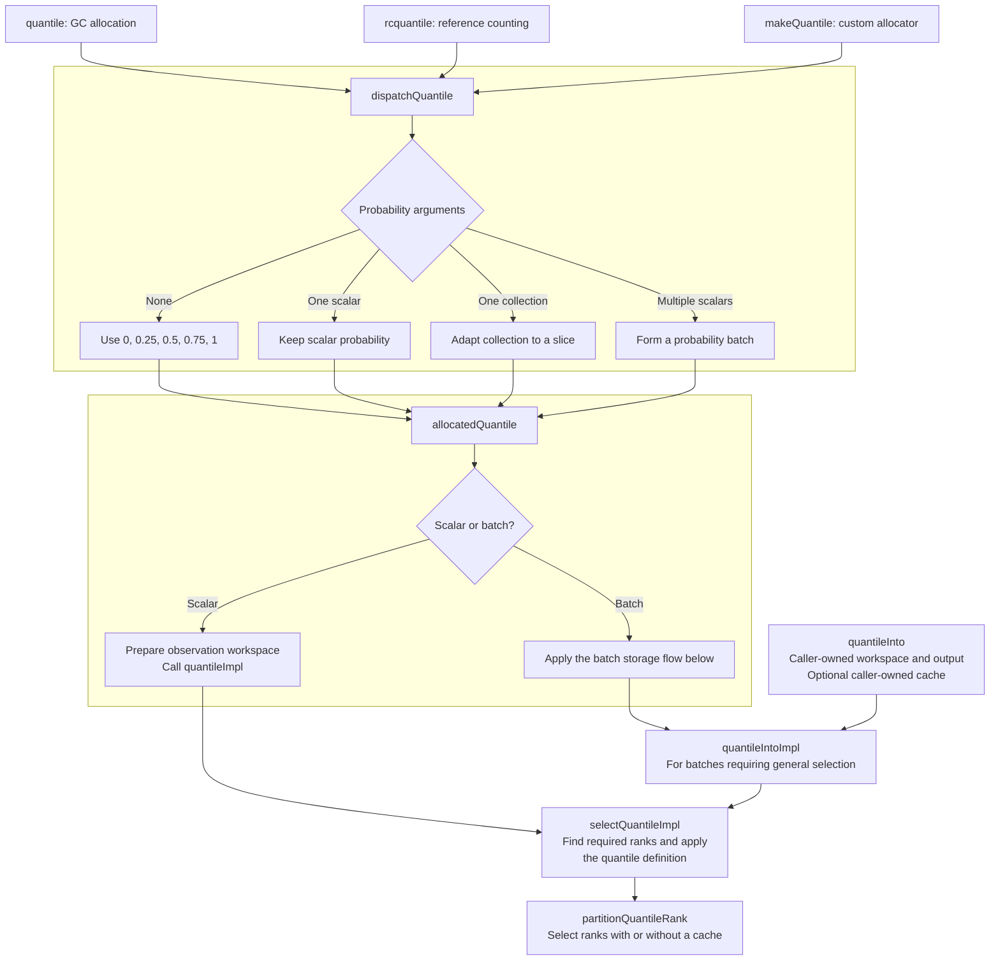
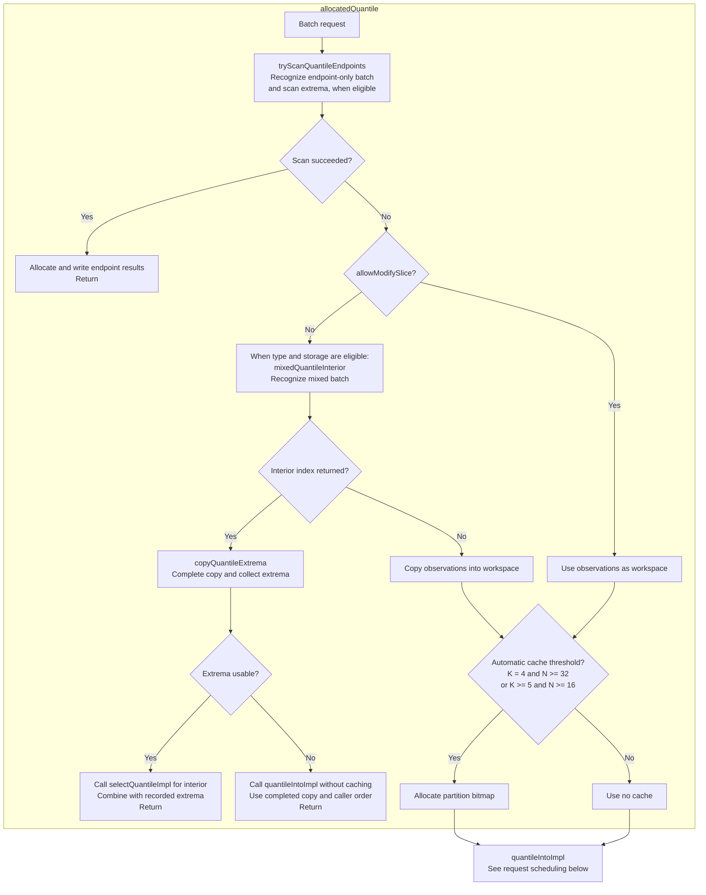
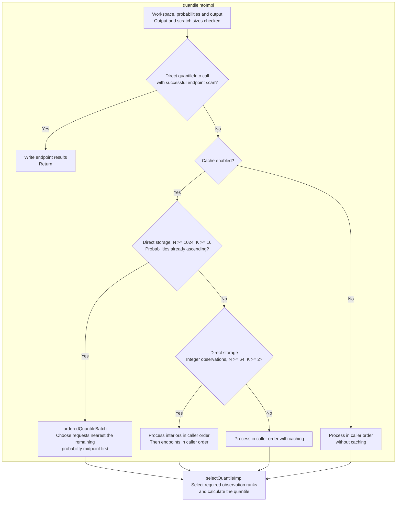

# Ordinary quantile selection

These diagrams describe how ordinary quantile calls prepare storage and select observations. They document internal implementation choices, including performance thresholds, rather than API guarantees. Weighted quantiles, scalar median functions, and persistent quantile tables are outside these diagrams' scope.

## Entry points and shared implementation

GC, RC, and custom-allocation quantile functions share the selection logic. Their allocation policy determines how temporary and result storage is owned and released. Boxes group work by function; a node naming another function represents a call to it.

`quantileInto` bypasses allocation and copying. Its scratch-buffer overload explicitly requests caching independently of the automatic thresholds used by allocating functions. Its overload without scratch performs uncached selection.

## Batch storage and shortcuts

**N** is the observation count and **K** is the probability count. Results always appear in the caller's probability order, even when computation happens in a different order. This diagram shows the batch path inside `allocatedQuantile`.

Type and storage eligibility is checked by `allocatedQuantile` before it calls the helpers. `mixedQuantileInterior` recognizes a batch of exactly three probabilities with N >= 64, beginning with an endpoint and containing both endpoints and one strictly interior probability. It returns index 1 or 2; zero means ordinary selection. This shortcut applies to integers, `float`, and `double` when copying is required.

For example, 100 integer observations and probabilities `[0, 0.5, 1]` use the copy to record the minimum and maximum, then select only the median. `[0.5, 0, 1]` retains ordinary caller-order selection. The shortcut does not apply to `real` mixed batches or to `allowModifySlice=true`.

## Request scheduling

This diagram shows `quantileIntoImpl`. Allocating functions have already checked endpoint shortcuts; direct `quantileInto` calls perform that check here, after validating output and scratch requirements. All paths below preserve output order.

The large ascending-batch schedule takes precedence over integer endpoint deferral. It chooses among requested probabilities without sorting the probability collection. Its probability midpoint is separate from the observation-slot pivot used by `partitionAtWithCache`.

`selectQuantileImpl` determines the ranks required by the chosen quantile definition. `partitionQuantileRank` delegates cached selection to `partitionAtWithCache` and uncached selection to ordinary `partitionAt`. The cache records established ranks, including intermediate pivots, for reuse within the batch.

## Type differences and fallbacks

| Behavior | Integers | float/double | real |
|---|---|---|---|
| Endpoint-only extrema scan | Comparisons | Ordered bit keys | Comparisons with signed-zero handling |
| Mixed-batch copy and extrema scan | Supported | Supported with fallback | Ordinary copy and selection |
| Cached interior-first, endpoints-last schedule | Supported | Caller order | Caller order |

- Endpoint-only scanning requires N >= 2, K >= 2, and every probability equal to 0 or 1. It requires directly stored observations and probabilities and a numeric result type. Direct quantileInto calls additionally require directly stored output.
- Floating endpoint scans fall back for NaNs. They resolve zero ties with negative zero as the minimum and positive zero as the maximum when both signs occur.
- Mixed float/double scans finish the copy but require ordinary selection if any NaN or negative zero occurs. Integer scans cannot require this fallback.
- Floating endpoint scans and mixed-batch copy shortcuts are bypassed during compile-time evaluation.
- Scheduling changes require directly stored workspace, probabilities, and output. Generic views retain the applicable general path, preserving observable iterator behavior. Copying a view can produce a directly stored workspace for subsequent selection.
- Two- and three-probability batches do not automatically allocate a cache. Callers of the scratch overload of `quantileInto` opt into caching explicitly.
- No shortcut sorts the entire observation workspace eagerly. Rank selection partitions observations as needed.

## Implementation and maintenance

Relevant functions are in [quantiles.d](../source/mir/stat/descriptive/univariate/quantiles.d): `dispatchQuantile`, `allocatedQuantile`, `tryScanQuantileEndpoints`, `mixedQuantileInterior`, `copyQuantileExtrema`, `quantileIntoImpl`, `orderedQuantileBatch`, `selectQuantileImpl`, and `partitionQuantileRank`.

Cached rank selection is implemented in [internal/partition.d](../source/mir/stat/descriptive/univariate/internal/partition.d).

Update this page when changing eligibility rules, thresholds, scheduling, allocation behavior, or helper boundaries. Keep numerical definitions and public contracts in the API documentation. Mermaid diagrams render directly on GitHub; edit their source here rather than maintaining separate image copies.

## Ordering weighted observations

Weighted quantiles and weighted tables share `prepareWeightedQuantileWorkspace`.
While copying positive-weight rows, it checks whether adjacent entries are in
ascending or descending order by value, using the raw weight to break ties.
Zero-weight rows are skipped. Ascending entries can be used immediately;
descending entries are reversed in the workspace. Once both directions are
ruled out, preparation finishes copying the rows and normally sorts them.

Equal-weight entries with opposite signed zeros use the usual sort as well,
so queries preserve the zero sign selected by that sort. Recognizing order
uses constant extra storage and takes at most linear time.

### Small relative inverse-CDF batches

For `inverseCDF` and `averagedInverseCDF` batches of 2 through 8 directly stored
probabilities, integer-typed relative weights can make selection cheaper than sorting. The GC, RC, and custom
allocator calls share this decision in `prepareWeightedQuantileWorkspace`.
Ascending and descending inputs take their existing paths first. Reusable
weighted tables use the ordinary preparation.

A single `averagedInverseCDF` request at exactly 0.5 can also use selection
when at least 16 rows have positive integer-typed weights. This includes
`weightedMedian`, its RC and custom-allocator variants, and a directly stored
one-element batch `[0.5]`. The scalar form reads the probability after copying the observations, so a
lazy input can update a probability passed by reference.
The same exact-sum check, signed-zero handling, and partition work limit apply.
Other single probabilities use ordinary preparation.

For example, a batch requesting the 25th and 75th percentiles partitions the
unordered workspace around a pivot. The total weights below and equal to the
pivot identify which requests it answers and which still need a lower or higher
value. Selection visits only ranges with outstanding requests and writes answers
in caller order. It keeps at most eight requests and answers on the stack.

`tryWeightedBatch` checks that the maximum weight times the number of positive
weights fits an exact integer bound for the accumulator. This makes partition
sums independent of addition order. A floating observation of negative zero
uses the ordinary sort to preserve tie behavior. Each pivot is the median of
three observations sampled near the quarter, halfway, and three-quarter
positions. If partitioning would visit more than eight times the original row
count, preparation sorts the partially partitioned workspace and evaluates the
entire batch from its cumulative weights.

With `averagedInverseCDF`, a query exactly at the end of a group of equal
values averages that value with the next distinct value. For example, with
values `[10, 20, 20, 30]` and equal weights, probabilities 0.5 and 0.75
return 20 and 25 respectively. At a boundary, selection scans the upper
partition for its minimum, charging the scan to the same work budget. When
the upper partition is empty, the nearest higher ancestor pivot supplies the
successor. Repeated requests at that boundary share the midpoint. Plain
`inverseCDF` omits this logic at compile time.

### Small frequency-weighted batches

For frequency `type7` and `type8`, an unordered workspace with at least 64
positive-weight rows can use partition selection for 2 through 8 directly stored
probabilities. The row count is the number of stored positive observations,
regardless of the sum of their occurrence counts. The cutoff avoids the cost
of preparing rank requests for small inputs. GC, RC, and custom allocator
calls share this path. Already ordered rows and reusable tables keep their
existing preparation.

`frequencyQuantileRank` supplies the same zero-based rank and interpolation
fraction for sorted lookup and batch selection, including the compensated
calculation for large totals. Each probability requests its rank and, for a
nonzero fraction, the adjacent rank. The partition traversal compares these
as one-based positions against exact cumulative occurrence counts. It keeps
up to sixteen requests and selected observations on the stack. If the ranks
select different values, their interpolation uses the original observation
type before conversion to the result type. For example, with values
`[10, 20, 30]` and counts `[1, 2, 1]`, the type 7 median is 20 and the 75th
percentile is 22.5. No call expands the counts into repeated observations.

The same partition work limit and negative-zero fallback apply as for relative
weights. Sorted lookup casts when both ranks fall within a single row and
interpolates when they span two rows. For integer observations, selection records
whether a selected value occurs in multiple rows. Only when such a tie makes
the two operations round differently does it defer to sorted lookup. Smaller workspaces and larger batches use sorted cumulative counts.
