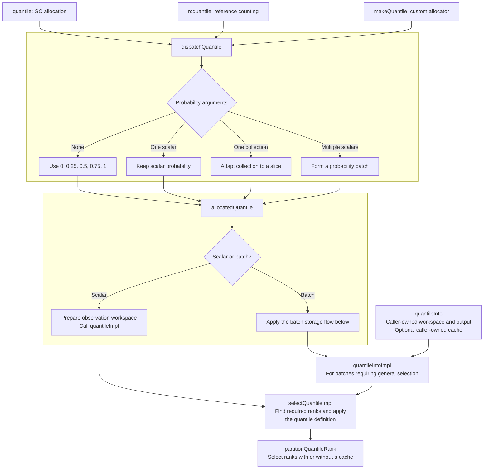
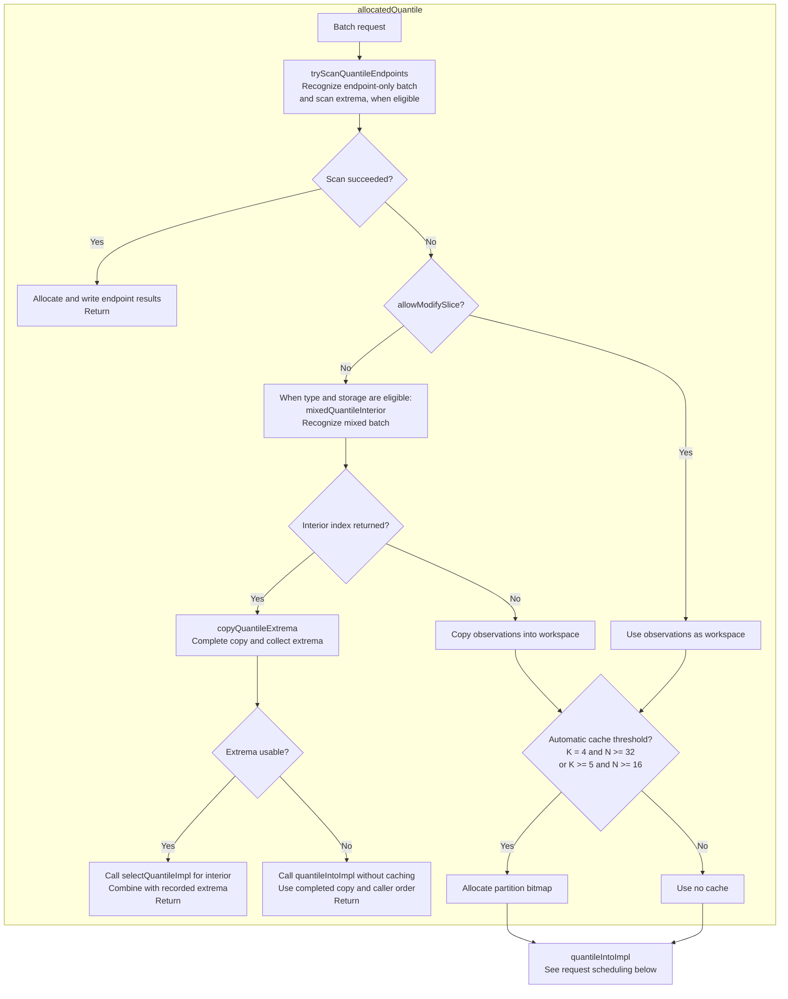
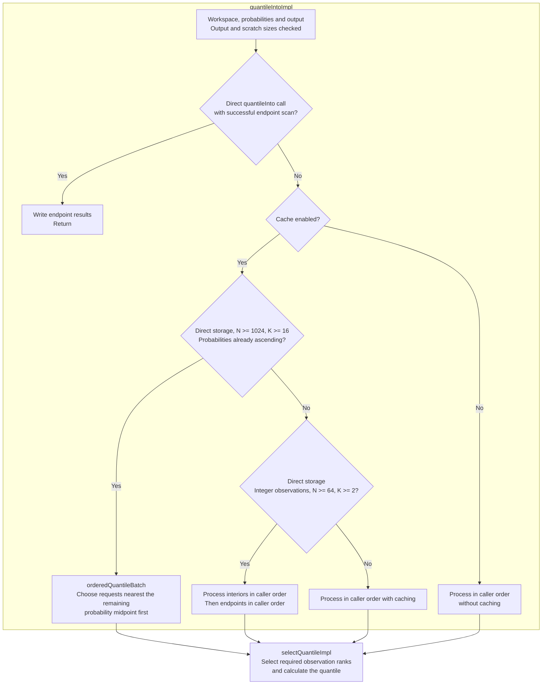

# Ordinary quantile selection

These diagrams describe how ordinary quantile calls prepare storage and select observations. They document internal implementation choices, including performance thresholds, rather than API guarantees. Weighted quantile selection, scalar median functions, and persistent quantile tables are outside these diagrams' scope. The note below describes shared cumulative-weight preparation for sorted weighted workspaces.

## Entry points and shared implementation

GC, RC, and custom-allocation quantile functions share the selection logic. Their allocation policy determines how temporary and result storage is owned and released. Boxes group work by function; a node naming another function represents a call to it.

`quantileInto` bypasses allocation and copying. Its scratch-buffer overload explicitly requests caching independently of the automatic thresholds used by allocating functions. Its overload without scratch performs uncached selection.

## Batch storage and shortcuts

**N** is the observation count and **K** is the probability count. Results always appear in the caller's probability order, even when computation happens in a different order. This diagram shows the batch path inside `allocatedQuantile`.

Type and storage eligibility is checked by `allocatedQuantile` before it calls the helpers. `mixedQuantileInterior` recognizes a batch of exactly three probabilities with N >= 64, beginning with an endpoint and containing both endpoints and one strictly interior probability. It returns index 1 or 2; zero means ordinary selection. This shortcut applies to integers, `float`, and `double` when copying is required.

For example, 100 integer observations and probabilities `[0, 0.5, 1]` use the copy to record the minimum and maximum, then select only the median. `[0.5, 0, 1]` retains ordinary caller-order selection. The shortcut does not apply to `real` mixed batches or to `allowModifySlice=true`.

## Request scheduling

This diagram shows `quantileIntoImpl`. Allocating functions have already checked endpoint shortcuts; direct `quantileInto` calls perform that check here, after validating output and scratch requirements. All paths below preserve output order.

The large ascending-batch schedule takes precedence over integer endpoint deferral. It chooses among requested probabilities without sorting the probability collection. Its probability midpoint is separate from the observation-slot pivot used by `partitionAtWithCache`.

`selectQuantileImpl` determines the ranks required by the chosen quantile definition. `partitionQuantileRank` delegates cached selection to `partitionAtWithCache` and uncached selection to ordinary `partitionAt`. The cache records established ranks, including intermediate pivots, for reuse within the batch.

## Type differences and fallbacks

| Behavior | Integers | float/double | real |
|---|---|---|---|
| Endpoint-only extrema scan | Comparisons | Ordered bit keys | Comparisons with signed-zero handling |
| Mixed-batch copy and extrema scan | Supported | Supported with fallback | Ordinary copy and selection |
| Cached interior-first, endpoints-last schedule | Supported | Caller order | Caller order |

- Endpoint-only scanning requires N >= 2, K >= 2, and every probability equal to 0 or 1. It requires directly stored observations and probabilities and a numeric result type. Direct quantileInto calls additionally require directly stored output.
- Floating endpoint scans fall back for NaNs. They resolve zero ties with negative zero as the minimum and positive zero as the maximum when both signs occur.
- Mixed float/double scans finish the copy but require ordinary selection if any NaN or negative zero occurs. Integer scans cannot require this fallback.
- Floating endpoint scans and mixed-batch copy shortcuts are bypassed during compile-time evaluation.
- Scheduling changes require directly stored workspace, probabilities, and output. Generic views retain the applicable general path, preserving observable iterator behavior. Copying a view can produce a directly stored workspace for subsequent selection.
- Two- and three-probability batches do not automatically allocate a cache. Callers of the scratch overload of `quantileInto` opt into caching explicitly.
- No shortcut sorts the entire observation workspace eagerly. Rank selection partitions observations as needed.

## Implementation and maintenance

Relevant functions are in [quantiles.d](../source/mir/stat/descriptive/univariate/quantiles.d): `dispatchQuantile`, `allocatedQuantile`, `tryScanQuantileEndpoints`, `mixedQuantileInterior`, `copyQuantileExtrema`, `quantileIntoImpl`, `orderedQuantileBatch`, `selectQuantileImpl`, and `partitionQuantileRank`.

Cached rank selection is implemented in [internal/partition.d](../source/mir/stat/descriptive/univariate/internal/partition.d).

Update this page when changing eligibility rules, thresholds, scheduling, allocation behavior, or helper boundaries. Keep numerical definitions and public contracts in the API documentation. Mermaid diagrams render directly on GitHub; edit their source here rather than maintaining separate image copies.

## Related weighted workspace preparation

`prepareWeightedQuantileWorkspace` prepares the sorted entries used by weighted
quantile calls and weighted tables. Its forward prefix pass uses
`cumulativeSumInto` over a writable view of the existing cumulative-weight field:

- Frequency counts use `ulong` and `Summation.naive`, preserving exact integer
  addition after the existing frequency validation.
- Relative inverse-CDF definitions apply the existing power-of-two normalization
  lazily, then insert each mass into the existing Kahan accumulator.
- Effective-size definitions lazily divide each mass by the existing maximum,
  using that same Kahan accumulation order and retaining its final state.

These views allocate no temporary arrays and add no traversal. Each raw weight
is read and normalized before its field is replaced by the inclusive prefix.
The reverse suffix/squared-weight pass, precision fallback, sorting order, and
query algorithms are unchanged.

## Relative type 7 and type 8 query intervals

For at most four positive-weight observations, `weightedUniformQuantileAt` keeps
the full scan to avoid binary-search overhead. For larger inputs, it searches
the prepared cumulative weights for the first and last observations overlapping
its probability window.
Upper-half queries search the suffix weights in reverse index order. Shifted
first-window type 7 queries compare boundaries after subtracting the same origin
used by their overlap calculation.

Both the value-scale scan and the coefficient/estimate scan visit only the
resulting observation interval. They retain ascending observation order, the
existing overlap expressions, Kahan accumulation, and final clamping. Boundary
searches add no storage. Query cost is O(log n + k), where k is the number of
observations in the selected interval; broad windows can still require O(n).
The separate compensated tiny-weight fallback retains its full scan. Frequency
quantiles, inverse-CDF queries, and Harrell-Davis calculations are unchanged.
