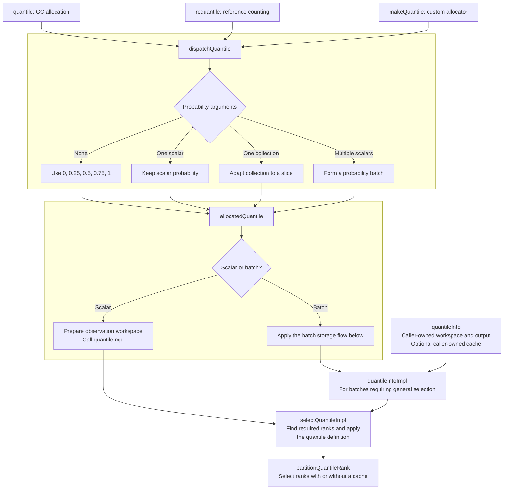
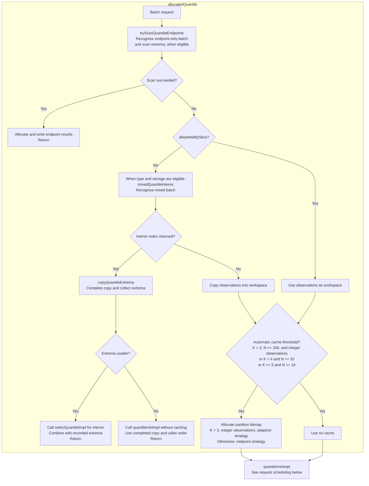
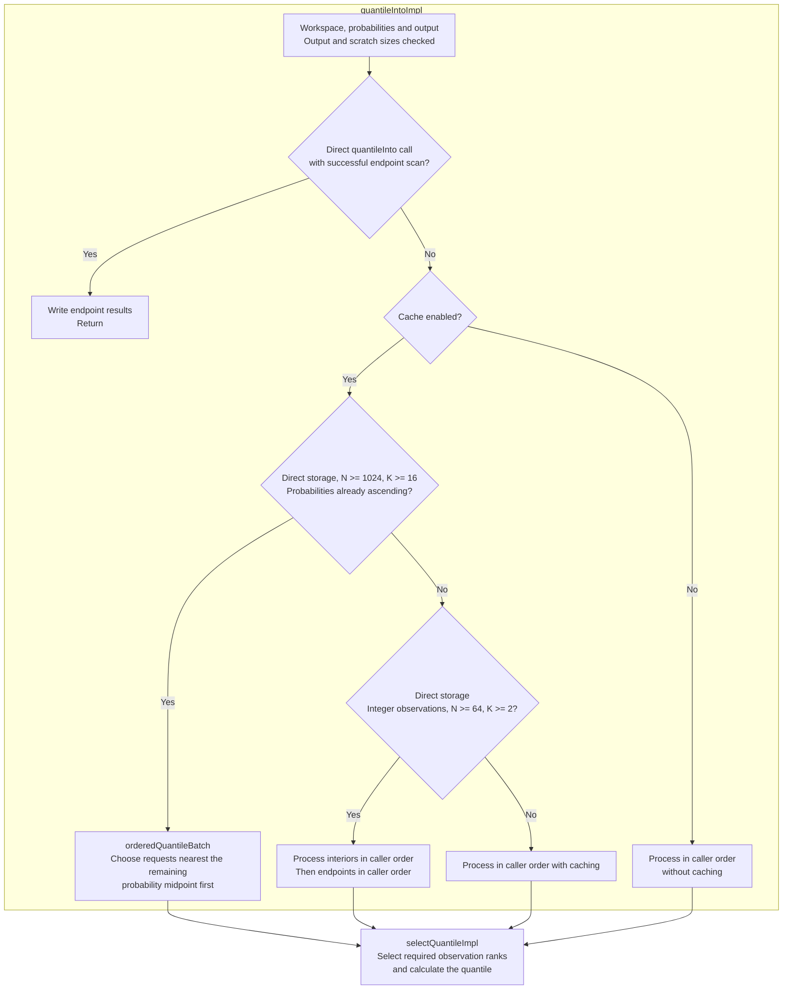

# Ordinary quantile selection

These diagrams describe how ordinary quantile calls prepare storage and select observations. They document internal implementation choices, including performance thresholds, rather than API guarantees. Weighted quantiles, scalar median functions, and persistent quantile tables are outside this page's scope.

## Entry points and shared implementation

GC, RC, and custom-allocation quantile functions share the selection logic. Their allocation policy determines how temporary and result storage is owned and released. Boxes group work by function; a node naming another function represents a call to it.



`quantileInto` bypasses allocation and copying. Its scratch-buffer overload explicitly requests caching independently of the automatic thresholds used by allocating functions. Its overload without scratch performs uncached selection.

## Batch storage and shortcuts

**N** is the observation count and **K** is the probability count. Results always appear in the caller's probability order, even when computation happens in a different order. This diagram shows the batch path inside `allocatedQuantile`.



Type and storage eligibility is checked by `allocatedQuantile` before it calls the helpers. `mixedQuantileInterior` recognizes a batch of exactly three probabilities with N >= 64, beginning with an endpoint and containing both endpoints and one strictly interior probability. It returns index 1 or 2; zero means ordinary selection. This shortcut applies to integers, `float`, and `double` when copying is required.

For example, 100 integer observations and probabilities `[0, 0.5, 1]` use the copy to record the minimum and maximum, then select only the median. `[0.5, 0, 1]` retains ordinary caller-order selection. The shortcut does not apply to `real` mixed batches or to `allowModifySlice=true`.
At 256 or more integer observations, `[0.5, 0, 1]` instead uses adaptive caching
and the interior-first, endpoints-last schedule; `[0, 0.5, 1]` still takes the
earlier copy-and-extrema shortcut when copying is required.

## Request scheduling

This diagram shows `quantileIntoImpl`. Allocating functions have already checked endpoint shortcuts; direct `quantileInto` calls perform that check here, after validating output and scratch requirements. All paths below preserve output order.



The large ascending-batch schedule takes precedence over integer endpoint deferral. It chooses among requested probabilities without sorting the probability collection. Its probability midpoint is separate from the observation-slot pivot used by `partitionAtWithCache`.

`selectQuantileImpl` determines the ranks required by the chosen quantile definition. `partitionQuantileRank` delegates cached selection to `partitionAtWithCache` and uncached selection to ordinary `partitionAt`. The cache records established ranks, including intermediate pivots, for reuse within the batch.

## Rank-selection entry points and pivot strategies

The internal `partitionAt` and `partitionAtWithCache` functions both accept a
compile-time `PartitionPivotStrategy` parameter. `partitionAt` defaults to
`rankGuided` for selection without pivot reuse. `partitionAtWithCache` defaults to
`midpoint` and requires a nonempty caller-owned bitmap for reuse across requests.
Allocating quantile calls with integer observations, three probabilities, and
N >= 256 select `adaptive`; other cached calls retain `midpoint`. Existing endpoint
shortcuts run before this choice. Newly cached batches follow the existing
interior-first, endpoints-last schedule when storage is eligible. The strategy
is internal and is not a new argument on the quantile API.

| Strategy | Selection within the unresolved interval | When it can help |
|---|---|---|
| `midpoint` (cached default) | Partition around the middle-slot value and use the existing poor-pivot budget | Reusing partitions across several later requests |
| `rankGuided` (uncached default) | Use mir-algorithm's Phobos-derived rank-guided sampling | Selecting ranks near an interval's ends |
| `adaptive` | Choose once per requested rank: rank guidance in the outer 1/16 of an interval of at least 128 elements; otherwise midpoint selection | Balancing the two approaches for three-probability integer batches |

With a cache, all strategies retain intermediate full-interval pivots.
A middle-slot value is not necessarily the median. Rank-guided sampling uses the
target rank to choose a sample pivot. Recursive pivots within a sample are not
recorded: they are not fixed positions in the full interval until expansion.

```d
// These functions are internal to mir-stat, not public quantile API options.
alias P = PartitionPivotStrategy;
partitionAt(values, rank); // Rank-guided selection, no cache or allocation.
partitionAt!(P.midpoint)(values, rank);
partitionAt!("a > b", P.adaptive)(values, rank);
partitionAtWithCache(values, rank, cache); // Existing midpoint strategy.
partitionAtWithCache!(P.rankGuided)(values, rank, cache);
partitionAtWithCache!(P.adaptive, "a > b")(values, rank, cache);
```

Cached calls share cache lookup and storage across strategies. A zeroed
caller-owned bitmap records established positions without allocating. A shorter bitmap records only positions
it covers, but it must be nonempty. For selection without storage, use the internal
`partitionAt` entry point: each call starts with the full workspace and records no
pivots. Reuse requires the same workspace, flattened order and comparison;
independently modifying the workspace requires clearing the bitmap.

Both entry points share slice normalization and selection logic. Compile-time
branches exclude bitmap lookup, bit-mask calculations, and pivot recording from
uncached instantiations; this does not depend on inlining or constant propagation.
Uncached rank-guided selection delegates directly to mir-algorithm's `partitionAt`; its
import is explicitly aliased inside the helper to avoid name collisions.
`partitionQuantileRank` routes uncached quantile calls through the internal
`partitionAt` entry point, retaining its rank-guided default independently of
the cached strategy. This includes scalar quantiles, uncached batches, and
uncached quantile spreads such as IQR. No bitmap is allocated or maintained.
Standalone median selection continues to call mir-algorithm directly.

The adaptive decision uses the nearest cached boundaries when available, or the
full workspace for an uncached call. For example, a request for rank 5 in an unresolved interval `[0, 256)` uses rank
guidance, while rank 128 uses midpoint selection. Interpolating quantiles can
request two ranks, and each rank has its own search. No strategy eagerly
sorts the entire workspace or changes the quantile definition.

## Symmetric quantile spreads (IQR)

`interquartileRange`, `rcInterquartileRange`, and `makeInterquartileRange`
share `allocatedQuantileSpread`. After preparing the observation workspace,
this helper uses a four-entry stack buffer when N >= 1024, the workspace has
pointer-backed numeric storage, and the probabilities form a symmetric pair
within [0.25, 0.75]. The same internal spread helper is used by `robustScale`.

Eligibility compares the larger probability with `1 - smaller` in the common
argument precision. It uses no tolerance and does not change either probability.
For example, [0.25, 0.75], [0.4, 0.6], and [0.5, 0.5] can qualify, including
reversed pairs. Rounding of mixed-precision arguments may conservatively bypass
this optimization. Non-symmetric pairs, wider pairs, and smaller inputs use the
existing uncached path. Generic in-place views also retain that path; copying a
view can produce an eligible workspace.

The queries retain caller order. `preparedQuantileSpread` uses
`selectQuantileImpl` with sparse requested-rank state, and `partitionQuantileRank`
restricts each subsequent rank selection to its nearest established boundaries.
Each quantile needs at most two ranks, so four entries suffice. Unlike the bitmap,
this buffer records only requested ranks, not intermediate pivots. Selection
remains rank-guided and the interpolation and spread arithmetic are unchanged.

The buffer allocates no GC, RC, or custom-allocator storage. Existing observation
copy ownership and `allowModifySlice` behavior are preserved. Quantile tables
and repeated histogram queries continue to use their persistent bitmaps.

## Type differences and fallbacks

| Behavior | Integers | float/double | real |
|---|---|---|---|
| Endpoint-only extrema scan | Comparisons | Ordered bit keys | Comparisons with signed-zero handling |
| Mixed-batch copy and extrema scan | Supported | Supported with fallback | Ordinary copy and selection |
| Cached interior-first, endpoints-last schedule | Supported | Caller order | Caller order |

- Endpoint-only scanning requires N >= 2, K >= 2, and every probability equal to 0 or 1. It requires directly stored observations and probabilities and a numeric result type. Direct quantileInto calls additionally require directly stored output.
- Floating endpoint scans fall back for NaNs. They resolve zero ties with negative zero as the minimum and positive zero as the maximum when both signs occur.
- Mixed float/double scans finish the copy but require ordinary selection if any NaN or negative zero occurs. Integer scans cannot require this fallback.
- Floating endpoint scans and mixed-batch copy shortcuts are bypassed during compile-time evaluation.
- Scheduling changes require directly stored workspace, probabilities, and output. Generic views retain the applicable general path, preserving observable iterator behavior. Copying a view can produce a directly stored workspace for subsequent selection.
- Three-probability batches automatically allocate a cache only for integer observations with N >= 256, using adaptive pivot selection. This includes `allowModifySlice=true` and all allocation policies. Two-probability batches and smaller or floating-point three-probability batches remain uncached. Direct callers of the scratch overload of `quantileInto` continue to use midpoint selection.
- No shortcut sorts the entire observation workspace eagerly. Rank selection partitions observations as needed.

## Implementation and maintenance

Relevant functions are in [quantiles.d](../source/mir/stat/descriptive/univariate/quantiles.d): `dispatchQuantile`, `allocatedQuantile`, `tryScanQuantileEndpoints`, `mixedQuantileInterior`, `copyQuantileExtrema`, `quantileIntoImpl`, `orderedQuantileBatch`, `selectQuantileImpl`, and `partitionQuantileRank`.

Cached rank selection and strategy dispatch are implemented in [internal/partition.d](../source/mir/stat/descriptive/univariate/internal/partition.d). The selector adapted from mir-algorithm's Phobos-derived rank-guided implementation lives in [internal/rank_partition.d](../source/mir/stat/descriptive/univariate/internal/rank_partition.d).

Update this page when changing eligibility rules, thresholds, scheduling, allocation behavior, or helper boundaries. Keep numerical definitions and public contracts in the API documentation. Mermaid diagrams render directly on GitHub; edit their source here rather than maintaining separate image copies.
